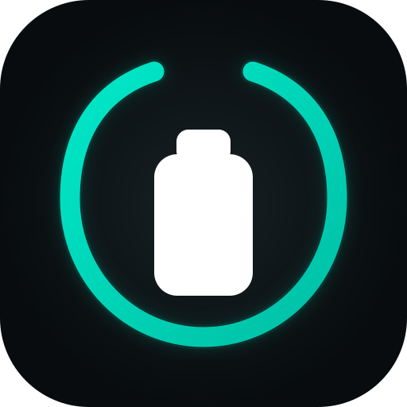

<p align="center"></p>

<h1 align="center">Watt</h1>
<p align="center"><em>Live charging-power monitor for Android.</em></p>

<p align="center"><a href="https://github.com/vortexnode/beam-live-notification-/releases/latest"></a></p>

Watt displays the phone's estimated charging power in a Live Update notification while a charger is connected. The notification is removed and the monitoring session ends when the cable is disconnected.

## Features

- Charging-power estimate refreshed approximately once per second.
- Designed for Android Live Updates and Samsung Now Bar on supported devices.
- Starts a charging session when external power is connected.
- Removes the Live Update and stops monitoring on disconnect.
- Android BatteryManager is the primary measurement source.
- Optional Shizuku shell reader for supported `/sys/class/power_supply` metrics.
- No root access required. Shizuku is optional; BatteryManager remains the fallback.
- No ads, analytics, or account sign-in.

## Measurement notes

The displayed value estimates power flowing into the battery-management system, calculated from battery current and voltage. It is not the charger's USB input power: phone consumption and conversion losses can make an external USB meter show a higher value. Device firmware determines which readings are available.

## Requirements

- Android 9 or newer.
- Notification permission.
- Android 16+ and a compatible system UI for promoted Live Update presentation.
- Shizuku permission is optional and only used when supported sysfs readings are available.

OEM interfaces may apply additional rules to Live Update promotion and display.

## Build

```sh
./gradlew :app:assembleDebug
```

Release builds are signed through the repository's configured CI signing secret. The application ID and signing identity are intentionally kept stable so existing installations can update in place.

## License

MIT. The upstream Beam project is acknowledged in the source history; Watt's focused charging-power interface and integration are maintained in this repository.
